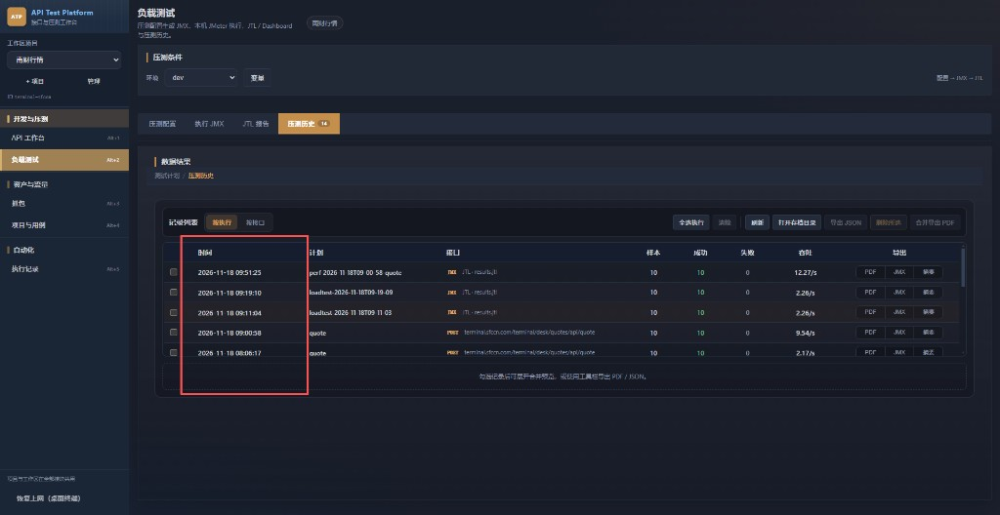
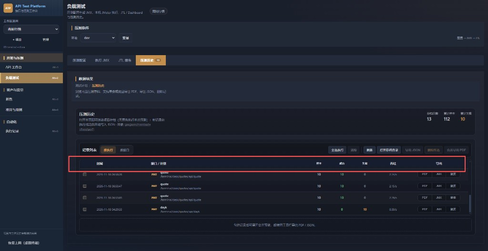
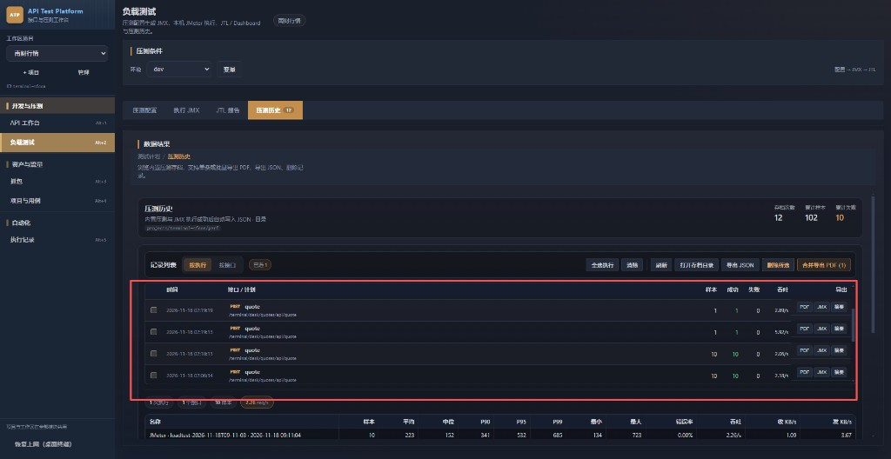
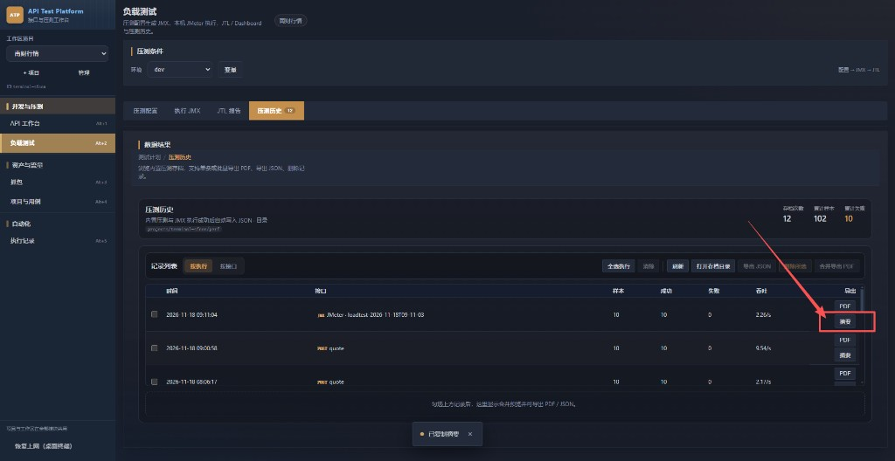
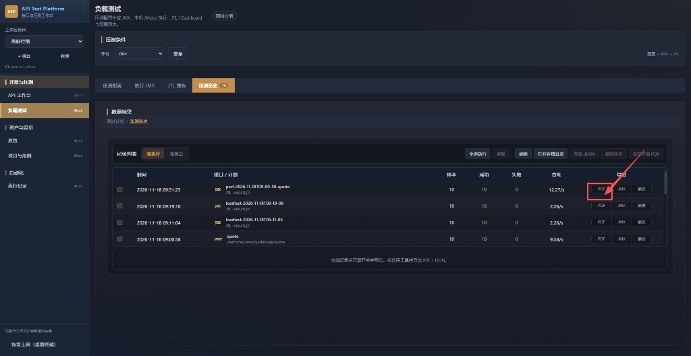
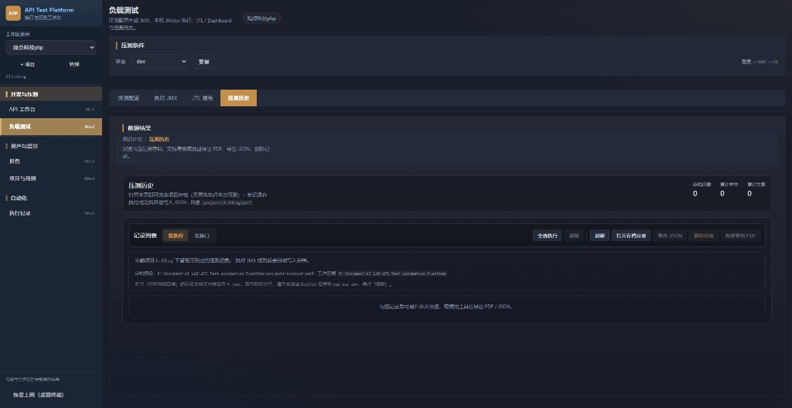

# API Test Platform 产品说明书

**版本**：桌面端 `api-test-automation-desktop@0.1.0`（Electron + React）  
**适用对象**：接口测试、抓包回放、YAML 自动化回归、JMeter 压测  
**数据形态**：纯文件仓库（无 SQLite），见 [FILE-STORE.md](./FILE-STORE.md)

---

## 1. 产品定位

API Test Platform（以下简称 **ATP**）是一套面向研发与测试的 **接口与压测工作台**，将以下能力整合在同一桌面应用中：

| 能力 | 说明 |
|------|------|
| HTTP / WebSocket 调试 | Postman 风格集合、环境变量、无 CORS 限制的主进程请求 |
| 流量抓包 | mitmproxy + WinHTTP/系统代理，支持桌面终端与内嵌 WebView |
| 用例资产 | YAML 用例、套件、环境分层；可导出 JMX |
| 自动化执行 | Python CLI 与桌面共用 `projects/`，产出 `runs/` 执行记录 |
| 负载测试 | JMeter 式计划树 → 生成 JMX → 本机 JMeter → JTL/Dashboard → **压测历史** |

---

## 2. 系统架构

```text
┌─────────────────────────────────────────────────────────────┐
│  Electron 桌面 (desktop/)                                    │
│  React 界面 │ preload IPC │ 主进程 (文件、JMeter、抓包、PDF)   │
└───────────────────────────┬─────────────────────────────────┘
                            │ 读写仓库根目录 (ATP_REPO_ROOT)
┌───────────────────────────▼─────────────────────────────────┐
│  仓库根目录                                                    │
│  projects/<id>/  cases, suites, environments, collections,    │
│                  jmx/, perf/, captures/                       │
│  runs/         执行索引与逐步明细                             │
│  atp/          python -m atp.cli …                           │
└─────────────────────────────────────────────────────────────┘
```

**设计原则**（与 README 一致）：

- 索引单写者、原子写、先明细后摘要  
- 密钥仅放在 `environments/*.local.yaml` 或环境变量，不入 Git  
- 桌面与 CLI **共用同一 `projects/`**，避免状态分裂  

---

## 3. 安装与启动

### 3.1 环境要求

- Windows 10/11（当前主要适配平台；抓包含 WinHTTP `netsh` 逻辑）  
- Node.js + `desktop/` 下 `npm install`  
- Python 3 + `pip install -r requirements.txt`（套件执行、CLI）  
- 可选：**JMeter 5.x**（`JMETER_HOME` 或界面填写安装目录）  
- 可选：**mitmproxy**（`requirements-capture.txt`）  

### 3.2 启动桌面端

```powershell
cd "D:\Document\AI LAB\API-Test-Automation-Platform\desktop"
npm install
npm run dev
```

- 仓库根默认 `desktop` 的上一级；可用环境变量 **`ATP_REPO_ROOT`** 覆盖。  
- 安装/镜像问题见 [README.md](../README.md)、[ELECTRON.md](./ELECTRON.md)。  

---

## 4. 全局界面与操作习惯

### 4.1 工作区

- 左侧边栏顶部的 **项目** 下拉为全局上下文：`API 工作台`、`负载测试`、`抓包`、`执行记录` 等均按当前项目读写 `projects/<id>/`。  
- 各模块顶栏 **环境**（如 `dev`）对应 `environments/<env>.yaml` 与 `*.local.yaml` 中的变量（含 token）。  
- **`+ 项目`** 创建新项目后通常进入「项目与用例」。  

### 4.2 导航分组与快捷键

| 分组 | 模块 | 快捷键 | 说明 |
|------|------|--------|------|
| 开发与压测 | API 工作台 | `Alt+1` | 调试请求、集合、可视化响应 |
| 开发与压测 | 负载测试 | `Alt+2` | JMX、JMeter、JTL、压测历史 |
| 资产与流量 | 抓包 | `Alt+3` | MITM、保存用例 |
| 资产与流量 | 项目与用例 | `Alt+4` | YAML、套件、批量 JMX |
| 自动化 | 执行记录 | `Alt+5` | 历史 run、断言明细 |

详见 [DESKTOP-UX.md](./DESKTOP-UX.md)。

### 4.3 跨模块数据流

```text
抓包 / 用例 YAML ──► API 工作台（集合、环境）
API 工作台 ──► 负载测试（draft + env + token）
API 工作台 ──► cases/*.yaml
python -m atp.cli run ◄── 项目与用例 / 执行记录
JMeter 执行完成 ──► perf/*.json（压测历史）
```

---

## 5. 模块说明（含界面截图）

### 5.1 API 工作台

**功能摘要**：集合树、Send 请求、Params/Headers/Body、响应 Body/Headers/**可视化**表格、导入 cURL、保存到集合/保存为用例、**发送到压测**。


*图 5-1：选择集合中的接口，配置 POST URL，顶栏切换 `dev` 环境。*


*图 5-2：`dayk` 接口 200 响应；「可视化」页签将 JSON 数组表格化，支持导出 XLSX/PNG。*

| 操作 | 结果路径 / 行为 |
|------|-----------------|
| 保存到集合 | `projects/<id>/collections/*.json` |
| 保存为用例 | `projects/<id>/cases/<name>.yaml`（`{{base_url}}`、断言等） |
| 发送到压测 | 跳转负载测试，带入 URL/Headers/Body 与当前环境变量 |

更多字段说明见 [API-WORKBENCH.md](./API-WORKBENCH.md)。

---

### 5.2 负载测试

负载测试页签顺序：**压测配置 → 执行 JMX → JTL 报告 → 压测历史**（末项带记录数角标）。执行成功后会自动归档并默认进入 **JTL 报告**。

#### 5.2.1 压测配置

对标 Apache JMeter：**测试计划 → 线程组 → HTTP 请求**；可从集合选择接口；支持线程数 / Ramp-Up / 循环等预设。


*图 5-3：计划树选中 HTTP 请求；右侧配置 URL、Body；可「生成 JMX 并执行」。*

生成 JMX 默认写入：`projects/<id>/jmx/loadtest-<时间戳>.jmx`。

#### 5.2.2 执行 JMX

选择本机 `.jmx` 与输出目录，检测 JMeter，支持 HTML Dashboard（`-e -o report`）、可选将 JMX 副本写入项目 `jmx/`。


*图 5-4：JMeter 路径、测试计划、输出目录与运行日志。*

#### 5.2.3 JTL 报告

加载 `results.jtl` 或归档目录下的 JTL，查看统计表、延迟分布、状态码；可生成 JMX、写入压测历史。  
**JTL 样本预览**与内置 HTTP 压测的 **请求样本** 表采用 **虚拟滚动**（`react-window`），避免一次挂载数万行 DOM。  
JMeter 官方 **HTML Dashboard** 可在内嵌浏览器或独立目录打开：


*图 5-5：Dashboard 示例（APDEX、请求汇总等）。*

历史行 **PDF** 在存在 JTL 时优先按 **JMeter Dashboard 风格** 再生 PDF，并在 Chromium 窗口中打开（缩放/搜索/打印）。

#### 5.2.4 压测历史

**按项目隔离**：记录保存在 `projects/<id>/perf/*.json`（同名 `.pdf` 可选）。无需先跑压测即可打开本页 **刷新** 列表。

**列表列**（当前版本）：

| 列 | 含义 |
|----|------|
| 时间 | 本地时区格式 `YYYY-MM-DD HH:mm:ss` |
| 计划 | JMX 运行：计划文件名；HTTP 内置压测：用例名 |
| 接口 | JMX：`JTL · 文件名`；HTTP：方法 + 路径 |
| 样本 / 成功 / 失败 / 吞吐 | 汇总指标 |
| 导出 | **PDF**（内嵌查看）、**JMX**、**摘要** |



*图 5-6：计划与接口分为两列；样本/成功/失败独立列。*



*图 5-7：多行 JMX 与 HTTP 混合记录；工具栏支持合并导出 PDF、删除所选、打开存档目录。*

**合并与预览**：勾选多条 → 可展开「合并预览」（聚合表、延迟分布、状态码图）→ **合并导出 PDF**。



*图 5-8：选中多条后的统计表与合并分布图。*

**行内操作**：

- **PDF**：强制按当前规则重生并打开 PDF 查看器。  
- **JMX**：优先打开 provenance / `jmeter.log` / 项目 `jmx/` 下关联文件。  
- **摘要**：弹窗展示文本摘要，可复制。



*图 5-9：行内「摘要」操作。*



*图 5-10：行内 PDF 导出入口。*

**按接口分组**：工具栏可切换「按执行 / 按接口」，用于跨多次运行对比同一端点。

**空列表说明**：若当前项目 `perf/` 无文件，列表为空；压测数据在其它项目时，请在左上角 **切换项目**（例如 `terminal-sfccn` 与 `bidding` 互不共享历史）。



*图 5-11：`bidding` 项目无 perf 记录时的空状态（需切换项目或在本项目执行 JMX）。*

---

### 5.3 抓包

**功能摘要**：启停 MITM、PAC/全局代理模式、流量列表过滤、明细打开到工作台、批量 **保存到项目用例**。

桌面客户端（WinHTTP）与浏览器分流策略见 [CAPTURE-DESKTOP-APP.md](./CAPTURE-DESKTOP-APP.md)；mitm 安装与 ingest 见 [CAPTURE-REAL-TRAFFIC.md](./CAPTURE-REAL-TRAFFIC.md)。

推荐流程简述：

1. 安装并信任 MITM 证书  
2. 选 **PAC（按域名）**，填写 API 主机或「项目 PAC 模板」  
3. **开始抓包** → 重启目标客户端 → 操作业务  
4. 保存用例 / 在工作台编辑 → **停止并恢复上网**  

---

### 5.4 项目与用例

管理 `project.yaml`、环境文件、YAML 用例、套件定义、API 集合引用。

典型能力：

- 编辑/运行套件目标用例列表  
- **生成 JMX（全部）** 或单用例 JMX → `projects/<id>/jmx/`  
- 将集合导入用例（与工作台联动）  

---

### 5.5 自动化：套件运行与执行记录

**套件运行**（`suite` 相关界面，可由侧栏自动化入口进入）：选择套件 + 环境 → 调用 `python -m atp.cli run`，结果写入 `runs/<id>/`。

**执行记录**：表格浏览历史 run（状态、时间、项目、套件）；点开查看 **summary** 与逐步 **steps** 断言。

CLI 等价操作：

```powershell
python -m atp.cli run -p <project> -s <suite> -e dev
python -m atp.cli runs list
```

---

## 6. 典型端到端场景

### 场景 A：从调试到压测

1. **API 工作台** 调通 `quote` 接口并保存到集合。  
2. 点击 **发送到压测** → **压测配置** 调整线程组 → **生成 JMX 并执行**。  
3. **JTL 报告** 查看结果；记录自动进入 **压测历史**。  
4. 历史行 **PDF** 交付报告；**JMX** 另存复跑。  

### 场景 B：抓包到回归

1. **抓包** 录制终端流量 → 多选保存为用例。  
2. **项目与用例** 纳入 `smoke` 套件。  
3. **执行记录** 中跑套件并查看失败步骤。  

### 场景 C：仅 JMeter 手工计划

1. **执行 JMX** 选择外部或项目内 `.jmx`。  
2. 完成后归档 JTL → **压测历史**。  
3. 合并多次运行导出一份 PDF 对比。  

---

## 7. 数据目录速查

```text
projects/<id>/
  project.yaml
  environments/       dev.yaml, dev.local.yaml（密钥）
  cases/*.yaml
  suites/*.yaml
  collections/*.json
  jmx/*.jmx           生成或导入的测试计划
  jmx/run_*/          JMeter 输出（results.jtl、report/）
  perf/*.json         压测历史主数据
  perf/*.pdf          可选缓存 PDF
  captures/           抓包会话（常 gitignore）

runs/
  index.json
  <run-id>/summary.json, steps/
```

---

## 8. 常见问题（FAQ）

| 现象 | 处理 |
|------|------|
| 压测历史为空 | 确认左上角项目是否正确；点 **刷新**；**打开存档目录** 看是否有 `*.json`；JMX 跑完后应自动写入 `perf/` |
| 时间差 8 小时 | 已按 **本地时区** 显示 `startedAt`；刷新界面后应为本机时间 |
| 历史 PDF 与 JTL 不一致 | 行内 PDF 会 **强制重生**；需存在 JTL 路径才会用 Dashboard 模板 |
| 导出 JMX 失败 | JMX 记录会沿 JTL 目录、`jmeter.log`、项目 `jmx/` 搜寻；可先将 JMX 存入 `projects/<id>/jmx/` |
| JTL 很大（数百 MB～GB） | 主进程 **按行流式解析**；在压测条件区选择 **JTL 解析** 模式：极速 800（默认）/ 标准 5000 / 深度 50000（分位数蓄水池） |
| 前端样本表卡顿 | **JTL 样本预览**、**HTTP 压测请求样本** 使用 `react-window` **虚拟列表**（约 ≥48 行启用）；仅渲染可视区域 DOM，与解析模式上限（最多约 5 万条预览）匹配 |
| P90/P95/P99 与 JMeter 略有差异 | 大文件下为 **流式蓄水池近似**；表头旁 **(i)** 悬停可见说明，属正常现象 |
| 工作台加载超时 | 检查 `ATP_REPO_ROOT`、磁盘权限；见启动 toast |
| 抓包无流量 | 勿把 API 域名放进「直连」；完全退出客户端后重开；见抓包文档 |

---

## 9. 相关文档索引

| 文档 | 内容 |
|------|------|
| [README.md](../README.md) | 仓库总览、CLI 快速开始 |
| [DESKTOP-UX.md](./DESKTOP-UX.md) | 桌面信息架构 |
| [API-WORKBENCH.md](./API-WORKBENCH.md) | 工作台与压测配置说明 |
| [FILE-STORE.md](./FILE-STORE.md) | 文件存储约定 |
| [CAPTURE-DESKTOP-APP.md](./CAPTURE-DESKTOP-APP.md) | 桌面终端抓包 |
| [CAPTURE-REAL-TRAFFIC.md](./CAPTURE-REAL-TRAFFIC.md) | mitm / ingest |
| [ELECTRON.md](./ELECTRON.md) | 打包与 Electron 问题 |

---

## 10. 文档修订

| 日期 | 说明 |
|------|------|
| 2026-11-18 | 初版：基于当前桌面功能与仓库内实景截图编制 |

截图存放路径：`docs/images/product-manual/`。在 Markdown 预览或 Git 托管中打开本文件即可与图片一并查看。

**PDF 版本**：[`PRODUCT-MANUAL.pdf`](./PRODUCT-MANUAL.pdf)（约 1.5 MB，含嵌入截图）。重新生成：

```powershell
cd docs
.\build-product-manual-pdf.ps1
```