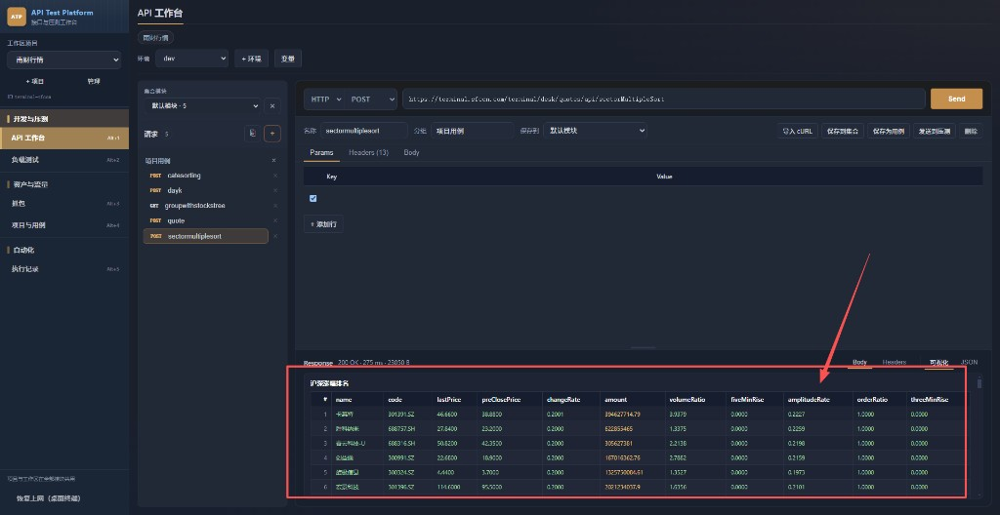
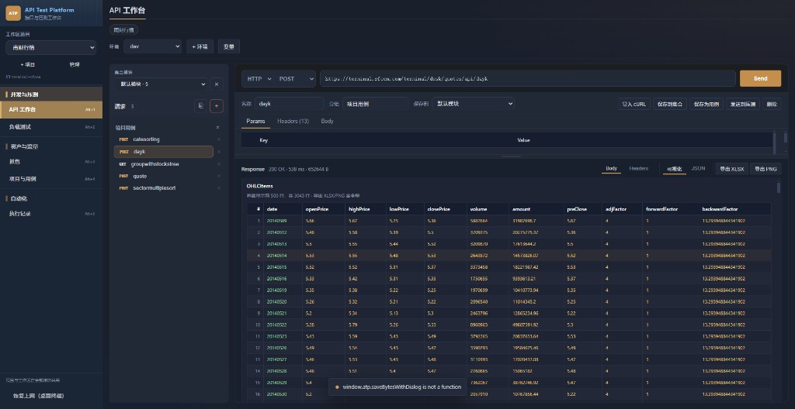
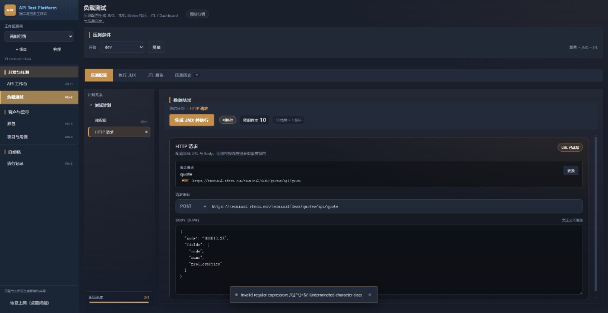
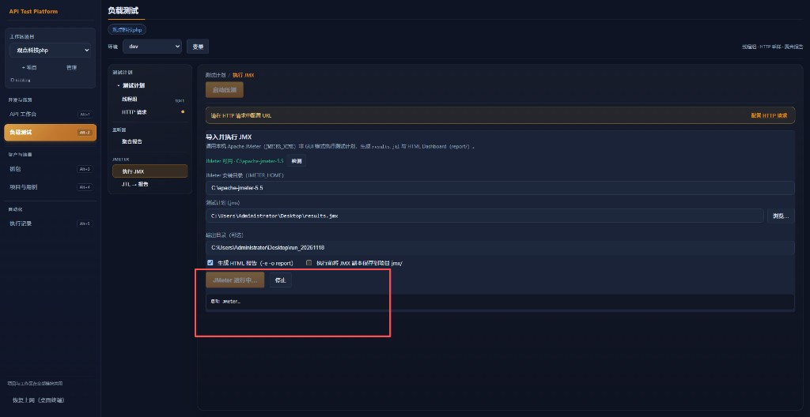
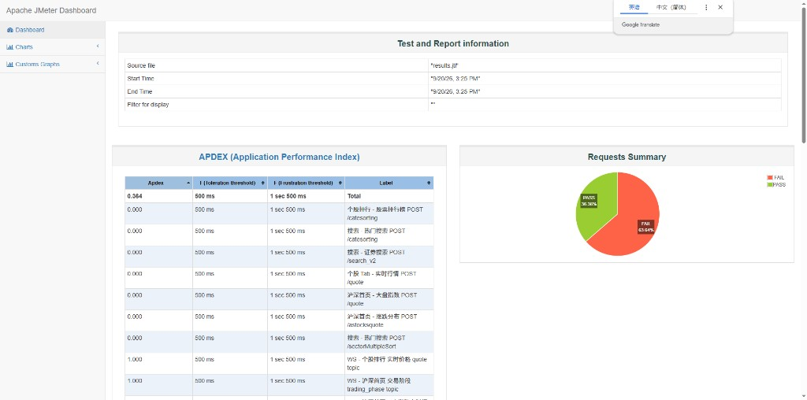

# API 测试平台 · 使用说明书

**产品名称**：API Test Platform（桌面端）  
**文档类型**：客户版 / 交付说明  
**软件版本**：0.1.0  
**适用读者**：测试工程师、接口联调人员、项目实施与运维支持（无需阅读源码即可上手）

---

## 1. 产品是什么

API 测试平台是一款 **Windows 桌面软件**，把日常最常用的接口与压测工作合在一个窗口里完成：

- **调试接口**：填写地址、参数、请求体，一键发送，查看响应（支持 JSON 表格化浏览与导出）。
- **管理资产**：按「项目」整理环境配置、用例、接口集合。
- **录制流量**：在受控代理下抓取真实请求，保存为用例或回到工作台继续编辑。
- **压力测试**：用图形界面配置线程与 HTTP 请求，生成 JMeter 脚本、执行并查看报告与历史记录。
- **自动化回归**：按套件批量执行用例，在执行记录里查看每一步是否通过。

数据保存在本机文件夹中（**不上传云端数据库**），便于内网交付、备份与审计。

---

## 2. 您将获得什么

| 您想做的事 | 在软件里去哪里 |
|------------|----------------|
| 临时调一个 HTTP 接口 | **API 工作台**（快捷键 `Alt+1`） |
| 把当前请求做成压测场景 | 工作台 → **发送到压测** → **负载测试** |
| 跑 JMeter、看 JTL 曲线与表格 | **负载测试** → 执行 JMX / JTL 报告 |
| 对比多次压测、导出 PDF 汇报 | **负载测试** → **压测历史** |
| 抓桌面程序或浏览器的 API | **抓包**（`Alt+3`） |
| 管理 YAML 用例、环境、集合 | **项目与用例**（`Alt+4`） |
| 查看历史自动化运行结果 | **执行记录**（`Alt+5`） |

---

## 3. 安装与第一次打开

### 3.1 推荐：使用安装包（适合客户现场）

在交付介质或构建目录中找到：

- **安装版**：`API Test Platform-0.1.0-x64.exe` — 按向导安装，可创建桌面快捷方式。  
- **便携版**：`API Test Platform-0.1.0-portable-x64.exe` — 解压即用，适合 U 盘或临时环境。

安装后双击 **「API Test Platform」** 启动。首次启动会加载内置项目模板；您也可以自己 **「+ 项目」** 新建。

> **说明**：完整「套件自动化执行」和「抓包 MITM」需要本机另行安装 **Python**；纯工作台调试、负载测试（配好 JMeter）可不装 Python。详见 [第 9 节](#9-环境准备给实施人员)。

### 3.2 可选：指定数据目录

默认使用安装目录下的平台数据。若需把用例与历史放到固定盘符（如 `D:\ATP-Data`），可设置 Windows 用户或系统环境变量：

**`ATP_REPO_ROOT`** = 该文件夹的完整路径（文件夹内需能正常使用 `atp`、`projects` 等目录结构；安装版首次运行已自带一份，可复制后改写）。

---

## 4. 三分钟快速入门

1. 启动软件，左上角 **项目** 下拉选择已有项目，或点 **「+ 项目」** 创建。  
2. 左侧点 **「API 工作台」**，或按 **`Alt+1`**。  
3. 选择请求方法（如 `GET`），填写 **URL**，需要时展开 **Params / Headers / Body**。  
4. 顶栏选择 **环境**（如 `dev`），环境中的变量会自动替换 URL 里的 `{{变量名}}`。  
5. 点击 **「发送」**，在下方查看状态码、耗时与响应内容。  
6. 若响应是 JSON，切换到 **「可视化」**，可像表格一样浏览字段；需要汇报时点 **「导出 ▾」** 另存为 Excel 或图片。



*图 1：选择集合中的接口、配置 URL 与环境后发送请求。*



*图 2：可视化视图支持勾选行后导出「所选」或导出「全部」数据。*

---

## 5. 界面怎么理解

### 5.1 全局习惯

- **项目**：一切数据都属于某个项目（不同项目之间的用例、压测历史互不混用）。  
- **环境**：同一项目下可有 `dev`、`test` 等；密钥请放在 `*.local.yaml`，勿外传。  
- **左侧导航**：分为「开发与压测」「资产与流量」「自动化」三组，带数字快捷键。  
- **通知条**：右下角短暂提示操作结果（保存成功、导出路径等）。

### 5.2 导航一览

| 快捷键 | 模块 | 一句话 |
|--------|------|--------|
| `Alt+1` | API 工作台 | 调试 HTTP / WebSocket，管理集合 |
| `Alt+2` | 负载测试 | 配计划、跑 JMeter、看 JTL 与历史 |
| `Alt+3` | 抓包 | 代理录制流量，保存用例 |
| `Alt+4` | 项目与用例 | 环境与 YAML 用例、导出 JMX |
| `Alt+5` | 执行记录 | 查看自动化运行历史与断言 |

---

## 6. 各模块怎么用（客户向）

### 6.1 API 工作台

**适合**：联调、排查、演示接口行为。

**常用操作**：

- **集合**：左侧树管理多接口；可导入 cURL，或 **保存到集合** / **保存为用例**。  
- **响应**：Raw / Headers / **可视化**；大 JSON 中复杂字段可点开展开详情侧栏。  
- **网络异常**：无法连接、证书错误时，界面会显示 **说明卡片**（非整屏乱码）；内网自签证书可在错误说明中尝试 **忽略证书校验** 后重发。  
- **发送到压测**：当前 URL、头、体与环境变量一键带到 **负载测试** 配置页。

### 6.2 负载测试

页内从左到右四个步骤：**压测配置 → 执行 JMX → JTL 报告 → 压测历史**。

**压测配置**  
像简化版 JMeter：测试计划 → 线程组 → HTTP 请求。填好 URL 与并发参数后，点 **「生成 JMX 并执行」**（会跳到执行页并调用本机 JMeter）。



*图 3：在计划树中选中 HTTP 请求，右侧编辑 URL 与 Body。*

**执行 JMX**  
选择本机 JMeter 安装目录、`.jmx` 文件与输出文件夹，查看实时日志。JMX 可存放在项目目录 `jmx/` 下便于版本管理。



*图 4：配置 JMeter 路径与输出目录后运行。*

**JTL 报告**  
打开 `results.jtl`，查看汇总、延迟分布、状态码；大文件采用流式解析，可在界面上选择解析深度。支持从 JTL **反向生成 JMX** 或写入 **压测历史**。



*图 5：可选打开 JMeter HTML 报告目录（APDEX、吞吐量等）。*

**压测历史**  
每次 JMX 或内置 HTTP 压测结束后，会生成一条记录，可：

- 单条 **PDF** 汇报（有 JTL 时按 Dashboard 风格生成）；  
- 勾选多条 **合并导出 PDF**；  
- 打开关联 **JMX** 再次执行。


*图 6：按计划、接口、成功失败等列浏览；右上角可刷新、打开存档目录。*

> **提示**：若列表为空，请先确认左上角 **项目** 是否与执行压测时一致；不同项目历史不共享。

### 6.3 抓包

**适合**：终端 App、内嵌浏览器等难以手写请求的场景。

**推荐流程**：

1. 按界面提示安装并信任 **MITM 根证书**（仅一次）。  
2. 选择 **按域名代理（PAC）** 或全局模式，填写要录制的 API 主机名。  
3. **开始抓包** → 完全退出并重启目标程序 → 操作业务。  
4. 在列表中选中请求 → 打开工作台编辑，或 **批量保存为用例**。  
5. 结束后 **停止抓包并恢复系统上网**，避免代理残留。

抓包能力依赖本机 **Python + mitmproxy**（见第 9 节）。

### 6.4 项目与用例

**适合**：正式资产沉淀与交付。

- 维护 **环境**（`dev.yaml` + 本地密钥文件）。  
- 编辑 **YAML 用例**、**套件**（一批用例的组合）。  
- 从集合或当前用例 **生成 JMX**，输出到 `projects/<项目名>/jmx/`。

### 6.5 执行记录

**适合**：自动化回归后的验收。

选择历史运行记录，查看摘要与各步骤的请求/响应、断言是否通过。可与命令行 `python -m atp.cli run` 结果一致（共用同一数据目录）。

---

## 7. 三个常见业务场景

### 场景 A：从联调到压测报告（最常见）

1. 在 **API 工作台** 调通行情/下单等接口并保存集合。  
2. **发送到压测** → 在 **压测配置** 调整线程数、Ramp-Up → **生成 JMX 并执行**。  
3. 在 **JTL 报告** 确认错误率为 0 或达预期。  
4. 在 **压测历史** 导出 **PDF**，作为测试报告附件。

### 场景 B：抓包到回归用例

1. **抓包** 录制一次真实业务流程。  
2. 多选关键请求 **保存为用例**。  
3. 在 **项目与用例** 纳入 `smoke` 套件。  
4. 在 **执行记录** 或套件运行中定期执行，关注失败步骤。

### 场景 C：已有 JMeter 脚本

1. 直接进入 **执行 JMX**，选择客户提供的 `.jmx`。  
2. 运行完成后自动归档 JTL。  
3. 在 **压测历史** 对比多次运行的吞吐与延迟，合并导出 PDF 给甲方。

---

## 8. 常见问题（客户向）

| 问题 | 建议处理 |
|------|----------|
| 打开软件后没有项目 | 点 **「+ 项目」** 新建，或检查 `ATP_REPO_ROOT` 是否指向含 `projects` 的目录。 |
| 发送请求一直失败 / 证书错误 | 看响应区 **错误卡片** 说明；内网 HTTPS 可尝试卡片中的证书校验选项后重发。 |
| 压测历史是空的 | 确认 **当前项目** 与压测时一致；点 **刷新**；用 **打开存档目录** 查看是否有记录文件。 |
| 导出 Excel/图片没反应 | 在 **可视化** 页签使用 **「导出 ▾」**；若系统拦截另存为，请选择有效文件夹（如「文档」）。 |
| 另存为 JMX 报「位置不可用」 | 目标文件夹不存在；请在对话框中选现有目录（如桌面或项目 `jmx` 目录）。 |
| JMeter 找不到 | 在 **执行 JMX** 页填写 **JMETER_HOME** 或安装路径，并确认本机已安装 JMeter 5.x。 |
| 抓包没有流量 | 确认目标程序已重启；域名未误入「直连」列表；抓包结束后务必 **恢复代理**。 |
| 套件执行按钮无反应 | 需安装 **Python** 与 `requirements.txt` 依赖，并在数据目录配置 `.venv`（见下节）。 |
| 时间与北京时间差 8 小时 | 界面已按 **本机时区** 显示；若仍异常请重启软件后再看。 |

---

## 9. 环境准备（给实施人员）

以下在 **客户内网部署** 时由实施同事一次性配置即可，不必写给最终业务用户。

| 组件 | 用途 | 说明 |
|------|------|------|
| **API Test Platform 安装包** | 桌面主程序 | 见 `desktop/release/` 或交付光盘 |
| **JMeter 5.x** | JMX 压测执行 | 配置 `JMETER_HOME` 或在界面填写 |
| **Python 3.10+** | 套件执行、抓包 CLI | `pip install -r requirements.txt`；抓包另装 `requirements-capture.txt` |
| **mitmproxy** | 抓包 | 随 capture 依赖安装；需信任根证书 |

数据目录结构（便于备份）：

```text
projects/<项目名>/
  environments/     环境与密钥（*.local.yaml 勿外传）
  cases/            用例
  collections/      接口集合
  jmx/              压测脚本与输出
  perf/             压测历史（JSON/PDF）
  captures/         抓包会话
runs/               自动化执行记录
```

更多技术约定见仓库内 `docs/FILE-STORE.md`、`README.md`（面向开发）。

---

## 10. 文档与版本

| 日期 | 说明 |
|------|------|
| 2026-11-19 | 客户版：强调安装包、入门路径与业务场景；补充可视化导出与网络错误提示 |
| 2026-11-18 | 初版技术说明书与截图 |

**生成 PDF（可选）**：在 `docs` 目录执行 `.\build-product-manual-pdf.ps1`（需本机安装 [Pandoc](https://pandoc.org/) 与 Microsoft Edge），输出 `PRODUCT-MANUAL.pdf` 便于邮件发送。

**截图目录**：`docs/images/product-manual/`

---

*本文档描述的是 API Test Platform 桌面端 0.1.0 功能；若界面与文字略有差异，以实际安装包为准。技术支持可附上项目名、环境名与操作步骤截图以便排查。*